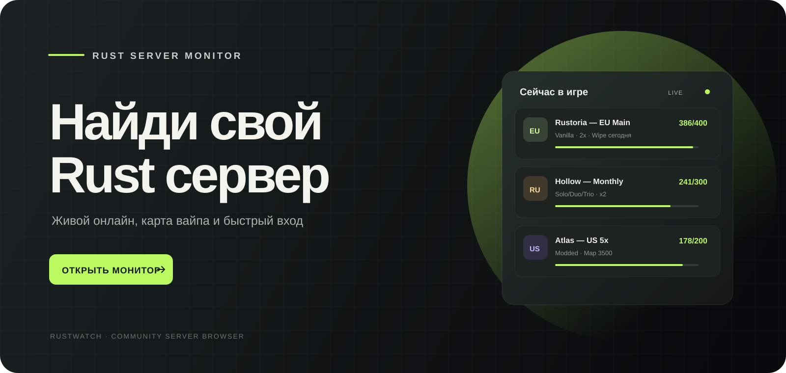
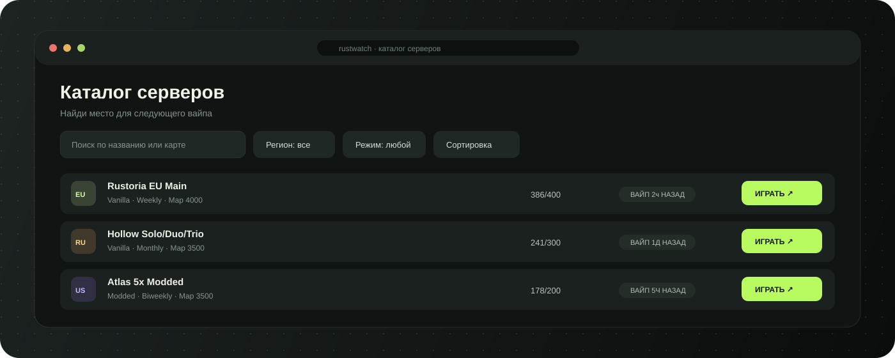

<div align="center">



### Каталог Rust-серверов с живым онлайном и быстрым подключением

[](https://shadyf315.github.io/rustwatch/)
[](https://github.com/shadyf315/rustwatch)
[](https://shadyf315.github.io/rustwatch/)

</div>

## О проекте

**RustWatch** помогает быстро выбрать Rust-сервер: посмотреть текущий онлайн, регион, режим и детали вайпа, отфильтровать список и скопировать команду подключения. Интерфейс адаптирован для компьютеров и телефонов.



## Возможности

- Актуальный список серверов и онлайн игроков.
- Поиск, фильтры и сортировка каталога.
- Быстрый переход на сайт сервера и подключение через команду `connect`.
- Отдельная страница профиля с коллекционными карточками.
- Получение 2 монет раз в 30 минут и сохранение прогресса в браузере.
- Автоматическое обновление данных через GitHub Actions.

## Страницы

| Раздел | Ссылка |
| --- | --- |
| Каталог серверов | [Открыть мониторинг](https://shadyf315.github.io/rustwatch/) |
| Профиль и карточки | [Открыть профиль](https://shadyf315.github.io/rustwatch/profile.html) |
| Исходный код | [GitHub репозиторий](https://github.com/shadyf315/rustwatch) |

## Данные серверов

Список формируется из API [BattleMetrics](https://www.battlemetrics.com/). GitHub Actions обновляет файл `data/servers.json` по расписанию, а сайт читает готовый JSON напрямую. Секрет API хранится в настройках репозитория и не попадает в браузерный код.

Чтобы включить обновление в своём форке:

1. Создайте секрет репозитория `BATTLEMETRICS_API_KEY` в **Settings → Secrets and variables → Actions**.
2. Убедитесь, что включён workflow `.github/workflows/publish-pages.yml`.
3. Для первичного запуска откройте **Actions → Update Rust server data → Run workflow**.

GitHub Actions запускает обновление примерно раз в пять минут. GitHub может немного сдвигать фактическое время запуска.

## Профиль и монеты

Профиль работает без регистрации. Баланс и карточки хранятся в `localStorage` этого браузера: они не синхронизируются между устройствами и могут пропасть после очистки данных сайта. Начисление монет — локальная функция интерфейса, а не серверная проверка аккаунта.

## Технологии

- HTML, CSS и JavaScript без сборщика.
- JSON-фид серверов.
- GitHub Actions для обновления данных и публикации GitHub Pages.

## Запуск локально

Откройте `index.html` в браузере или запустите любой локальный HTTP-сервер из корня проекта. Для работы с JSON-фидом удобнее использовать HTTP, например:

```bash
python -m http.server 8000
```

Затем откройте [http://localhost:8000](http://localhost:8000).

---

<div align="center">Сделано для Rust-комьюнити · <a href="https://shadyf315.github.io/rustwatch/">RustWatch</a></div>
